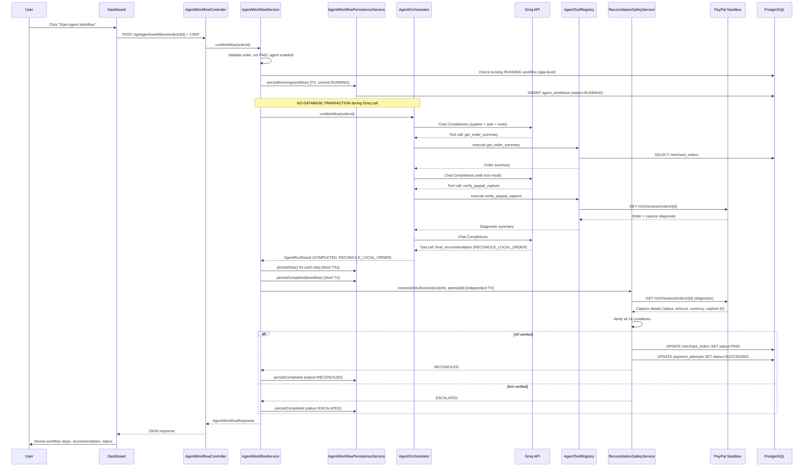

# RetryGuard AI — Architecture Documentation

## 1. Architectural Style

**Modular Monolith** — A single deployable Spring Boot application with clear internal module boundaries. HTTP controllers delegate to domain services; services use Spring Data JPA repositories; external integrations (PayPal, Groq) are encapsulated in dedicated clients. The deterministic investigation engine is the authority for payment decisions; the AI agent is strictly advisory and read-only.

```
┌─────────────────────────────────────────────────────────────────┐
│                     Spring Boot Application                      │
│  ┌──────────────┐  ┌──────────────┐  ┌──────────────────────┐  │
│  │  Controllers │──│   Services   │──│     Repositories     │  │
│  │  (REST API)  │  │  (Domain)    │  │  (Spring Data JPA)   │  │
│  └──────────────┘  └──────┬───────┘  └──────────┬───────────┘  │
│                           │                     │              │
│         ┌─────────────────┼─────────────────────┼──────────┐  │
│         ▼                 ▼                     ▼          ▼  │
│  ┌────────────┐  ┌──────────────┐  ┌──────────────────┐ ┌───────┐
│  │ Investigation│  │   Agent      │  │  Reconciliation  │ │ PayPal│
│  │   Service   │  │  Workflow    │  │   Safety Svc     │ │Client │
│  │ (Deterministic)│  │  (Groq)     │  │  (Verification)  │ │       │
│  └────────────┘  └──────────────┘  └──────────────────┘ └───────┘
│                           │                     ▲          ▲      │
│         ┌─────────────────┴─────────────────────┼──────────┘      │
│         ▼                                       ▼                 │
│  ┌────────────────────────────────────────────────────────────┐  │
│  │                    PostgreSQL Database                       │  │
│  │  merchant_orders · payment_attempts · payment_events        │  │
│  │  investigations · investigation_history                     │  │
│  │  agent_workflows · agent_workflow_steps                     │  │
│  └────────────────────────────────────────────────────────────┘  │
└─────────────────────────────────────────────────────────────────┘
                              ▲                 ▲
                              │                 │
                        HTTPS │             HTTPS │
                              │                 │
                        ┌─────┴─────┐     ┌─────┴─────┐
                        │ PayPal    │     │ Groq      │
                        │ Sandbox   │     │ API       │
                        └───────────┘     └───────────┘
```

---

## 2. Component Responsibilities

| Layer | Components | Responsibility |
|-------|------------|----------------|
| **Controllers** | `MerchantOrderController`, `PaymentAttemptController`, `PaypalPaymentController`, `PaypalWebhookController`, `InvestigationController`, `InvestigationQueryController`, `InvestigationExplanationController`, `PaymentTimelineController`, `AgentWorkflowController`, `PaymentEventController` | HTTP request handling, validation, response mapping, auth/CSRF enforcement |
| **Domain Services** | `MerchantOrderService`, `PaymentAttemptService`, `PaymentEventService`, `PaypalPaymentService`, `PaypalWebhookService`, `PaypalWebhookEventProcessor`, `InvestigationService`, `InvestigationExplanationService`, `InvestigationExplanationPersistenceService`, `PaymentTimelineService`, `AgentWorkflowService`, `AgentWorkflowPersistenceService`, `StuckOrderDetectionService`, `ReconciliationSafetyService`, `PaypalPaymentPersistenceService` | Business logic, orchestration, transaction boundaries, external client coordination |
| **External Clients** | `PaypalClient`, `GroqAgentProvider` | HTTP communication with PayPal Sandbox & Groq API; request/response mapping |
| **AI Agent** | `AgentOrchestrator`, `GroqAgentProvider`, `AgentToolRegistry`, `AgentProperties` | Multi-turn function-calling loop; tool allowlist; bounded execution; safety |
| **Repositories** | `MerchantOrderRepository`, `PaymentAttemptRepository`, `PaymentEventRepository`, `InvestigationRepository`, `InvestigationHistoryRepository`, `AgentWorkflowRepository`, `AgentWorkflowStepRepository` | Spring Data JPA data access; custom queries (e.g., `findRunningByOrderId`) |
| **Entities** | `MerchantOrder`, `PaymentAttempt`, `PaymentEvent`, `Investigation`, `InvestigationHistory`, `AgentWorkflow`, `AgentWorkflowStep` | JPA mappings; enums for statuses; JSONB for flexible payloads |
| **Security** | `SecurityConfig`, `SecurityUserConfig`, `SecurityProperties`, `CsrfCookieFilter`, `GlobalExceptionHandler` | Auth (Basic + form), CSRF, CORS, exception handling, user provisioning |
| **Configuration** | `AgentProperties`, `PaypalProperties`, `SecurityProperties`, `AiConfiguration` | Type-safe binding of env vars; validation |

---

## 3. Package Structure

```
com.retryguard_ai
├── ai                          # Groq agent integration
│   ├── AgentOrchestrator.java      # Multi-turn loop, tool execution
│   ├── AgentProperties.java        # Configuration binding
│   ├── AgentToolRegistry.java      # Allowlisted read-only tools
│   ├── AiConfiguration.java        # RestClient, GroqAgentProvider beans
│   ├── GroqAgentProvider.java      # Groq HTTP client + function calling
│   └── ToolDefinition.java         # Tool spec + executor (in GroqAgentProvider)
├── controller                  # REST endpoints
│   ├── AgentWorkflowController.java
│   ├── InvestigationController.java
│   ├── InvestigationExplanationController.java
│   ├── InvestigationQueryController.java
│   ├── MerchantOrderController.java
│   ├── PaypalPaymentController.java
│   ├── PaypalWebhookController.java
│   ├── PaymentAttemptController.java
│   ├── PaymentEventController.java
│   └── PaymentTimelineController.java
├── dto                         # API request/response records
│   ├── AgentWorkflowListResponse.java
│   ├── AgentWorkflowResponse.java
│   ├── AgentWorkflowStepResponse.java
│   ├── AutopsyFinding.java
│   ├── CreateOrderRequest.java
│   ├── CreateOrderResponse.java
│   ├── CreatePaymentAttemptRequest.java
│   ├── CreatePaymentAttemptResponse.java
│   ├── InvestigationExplanationResponse.java
│   ├── InvestigationHistoryResponse.java
│   ├── InvestigationResponse.java
│   ├── OrderTimelineEntry.java
│   ├── OrderTimelineResponse.java
│   ├── PaypalPaymentResponse.java
│   ├── PaypalWebhookResponse.java
│   ├── RecordPaymentEventRequest.java
│   └── RecordPaymentEventResponse.java
├── entity                      # JPA entities
│   ├── AgentWorkflow.java
│   ├── AgentWorkflowStep.java
│   ├── Investigation.java
│   ├── InvestigationHistory.java
│   ├── MerchantOrder.java
│   ├── PaymentAttempt.java
│   └── PaymentEvent.java
├── exception                   # Custom exceptions
│   ├── GlobalExceptionHandler.java
│   ├── InvestigationNotFoundException.java
│   ├── InvalidPaypalWebhookRequestException.java
│   ├── InvalidPaypalWebhookSignatureException.java
│   ├── InvalidPaymentEventPayloadException.java
│   ├── MerchantOrderAlreadyExistsException.java
│   ├── MerchantOrderNotFoundException.java
│   ├── PaymentAttemptNotFoundException.java
│   ├── PaypalOperationNotAllowedException.java
│   └── ProviderEventIdConflictException.java
├── paypal                      # PayPal client & DTOs
│   ├── PaypalClient.java
│   ├── PaypalClientConfiguration.java
│   ├── PaypalOrderResult.java
│   ├── PaypalCaptureResult.java
│   ├── PaypalOrderDiagnostic.java (inner)
│   ├── PaypalOrderUnitDiagnostic.java (inner)
│   ├── PaypalApprovalLink.java (inner)
│   ├── PaypalProperties.java
│   └── PaypalWebhookTransmission.java
├── repository                  # Spring Data JPA repositories
│   ├── AgentWorkflowRepository.java
│   ├── AgentWorkflowStepRepository.java
│   ├── InvestigationHistoryRepository.java
│   ├── InvestigationRepository.java
│   ├── MerchantOrderRepository.java
│   ├── PaymentAttemptRepository.java
│   └── PaymentEventRepository.java
├── security                    # Security configuration
│   ├── SecurityConfig.java
│   ├── SecurityUserConfig.java
│   ├── SecurityProperties.java
│   └── CsrfCookieFilter.java (inner class in SecurityConfig)
├── service                     # Domain services
│   ├── AgentWorkflowPersistenceService.java
│   ├── AgentWorkflowService.java
│   ├── InvestigationExplanationPersistenceService.java
│   ├── InvestigationExplanationService.java
│   ├── InvestigationService.java
│   ├── MerchantOrderService.java
│   ├── PaymentAttemptService.java
│   ├── PaymentEventService.java
│   ├── PaymentTimelineService.java
│   ├── PaypalPaymentPersistenceService.java
│   ├── PaypalPaymentService.java
│   ├── PaypalWebhookEventProcessor.java
│   ├── PaypalWebhookService.java
│   ├── ReconciliationSafetyService.java
│   └── StuckOrderDetectionService.java
└── RetryguardAiApplication.java
```

---

## 4. Key Design Decisions

### 4.1 Deterministic Authority Over AI

**Decision:** The `InvestigationService` (deterministic rules) is the sole authority for payment decisions. The Groq agent is advisory only.

**Rationale:** Payment decisions involve financial risk. Generative AI cannot be held accountable and may hallucinate. Conservative rules with evidence-linked findings provide auditability and safety.

**Enforcement:**
- `InvestigationService` runs in a `@Transactional(REPEATABLE_READ)` method
- Agent tools are read-only (`AgentToolRegistry` — all tools query, none mutate)
- `ReconciliationSafetyService` independently re-verifies PayPal before any state change
- `final_recommendation` tool only returns `RECONCILE_LOCAL_ORDER`, `WAIT_FOR_WEBHOOK`, or `ESCALATE`
- `RECONCILE_LOCAL_ORDER` triggers Java safety gate, not direct state change

### 4.2 Transaction Boundaries Around External Calls

**Decision:** Groq HTTP calls execute **outside** any database transaction.

**Implementation:**
- `AgentWorkflowService.runWorkflow()` is **not** `@Transactional`
- RUNNING workflow persisted via `AgentWorkflowPersistenceService.persistRunning()` (separate bean, `@Transactional`) — committed before Groq call
- Groq execution via `AgentOrchestrator.runWorkflow()` — no DB transaction active
- Results/steps persisted via `persistCompleted()` / `persistStep()` (short transactions)
- ERROR persisted via `persistError()` with `PROPAGATION_REQUIRES_NEW` on separate bean

**Why separate bean?** Spring's `@Transactional` uses proxies; self-invocation bypasses the proxy. `AgentWorkflowPersistenceService` is injected into `AgentWorkflowService`, so `persistError()` goes through the proxy and `REQUIRES_NEW` is honored.

### 4.3 Concurrency Control at Database Level

**Decision:** PostgreSQL partial unique index enforces at most one RUNNING workflow per order.

**Migration V5:**
```sql
CREATE UNIQUE INDEX IF NOT EXISTS uq_agent_workflows_one_running_per_order
    ON agent_workflows (order_id)
    WHERE status = 'RUNNING';
```

**Application handling:** `AgentWorkflowService` catches `DataIntegrityViolationException`, checks for constraint name `uq_agent_workflows_one_running_per_order`, returns `SKIPPED · WORKFLOW_ALREADY_RUNNING` without invoking Groq.

**Also:** Webhook idempotency via V1 partial unique index on `payment_events(provider, provider_event_id) WHERE provider_event_id IS NOT NULL`.

### 4.4 No Automatic Migrations

**Decision:** `spring.jpa.hibernate.ddl-auto=validate`. Additive migrations (V1–V5) applied manually via `psql`.

**Rationale:** Explicit control over schema changes in demo environment; avoids accidental data loss; matches PostgreSQL-specific partial indexes that don't translate to H2.

### 4.5 CSRF Cookie Emission on Every Response

**Decision:** `CsrfCookieFilter` (extends `OncePerRequestFilter`, placed after `BasicAuthenticationFilter`) eagerly calls `csrfToken.getToken()` to force `XSRF-TOKEN` cookie emission.

**Why:** Spring's `CsrfTokenRequestAttributeHandler` defers token resolution; without eager access, the first mutating request from the browser dashboard fails with 403 because the cookie was never set.

### 4.6 CORS Defaults Include ngrok Patterns

**Decision:** Default `CorsConfiguration` includes `https://*.ngrok-free.dev`, `https://*.ngrok-free.app`, `https://*.ngrok.io`, plus `PAYPAL_PUBLIC_BASE_URL` env var.

**Why:** PayPal Sandbox webhooks and return/cancel redirects require a public HTTPS URL; ngrok is the standard local tunneling tool. Wildcard-with-credentials is avoided; specific patterns used instead.

### 4.7 PayPal Return & Cancel Both Public

**Decision:** Both `GET /api/payment-attempts/*/paypal/return` and `.../cancel` are in `permitAll()`.

**Why:** Browser redirects from PayPal cannot carry authentication; both must be accessible without login. Token validation still occurs in `PaypalPaymentService.validateReturn/validateCancellation`.

### 4.8 Deterministic Explanation Only (Gemini Removed)

**Decision:** `InvestigationExplanationService` builds explanation from investigation's own decision/reason/rules/findings. No external provider call. Response `source = DETERMINISTIC`.

**Why:** Removes external dependency; eliminates API key requirement; guarantees consistent, auditable output; aligns with "AI never changes deterministic decision" principle.

---

## 5. Data Flow: Key Scenarios

### 5.1 Payment Autopsy Investigation

```
POST /api/orders/{id}/investigations
       │
       ▼
InvestigationController.investigate()
       │
       ▼
InvestigationService.investigate() [@Transactional REPEATABLE_READ]
       │
       ├── Load order, attempts, events
       ├── Build evidence snapshots (trusted = PAYPAL_SANDBOX + PROVIDER + VERIFIED)
       ├── Apply rules v1.0 (15-min freshness)
       │     ├── RETRY_ELIGIBLE: all failed attempts have fresh verified denials
       │     ├── RECONCILE: conflicting verified outcomes
       │     └── WAIT: uncertainty, pending, stale, or confirmed payment
       ├── Generate AutopsyFinding[] with evidence refs (ORDER/PAYMENT_ATTEMPT/PAYMENT_EVENT IDs)
       ├── Persist Investigation (evidence_snapshot JSONB, findings JSONB)
       ├── Persist InvestigationHistory (audit trail)
       └── Return InvestigationResponse
```

### 5.2 Agent Workflow Execution

```
POST /api/agent/workflows/orders/{id}
       │
       ▼
AgentWorkflowController.runWorkflow()
       │
       ▼
AgentWorkflowService.runWorkflow()  [NOT @Transactional]
       │
       ├── Validate order, not PAID, agent enabled
       ├── Check existing RUNNING workflow (app-level + DB constraint)
       ├── persistenceService.persistRunning(workflow)  [commits RUNNING]
       │
       ├── agentOrchestrator.runWorkflow(orderId)  [NO DB TRANSACTION]
       │     ├── System prompt + user message
       │     ├── Loop: max 5 turns, max 8 tool calls
       │     │     ├── Call Groq Chat Completions
       │     │     ├── If tool call: validate tool name, execute via AgentToolRegistry
       │     │     │     ├── get_order_summary / get_payment_attempts / get_verified_webhook_summary
       │     │     │     ├── get_latest_investigation / verify_paypal_capture
       │     │     │     └── final_recommendation
       │     │     ├── Append tool result to messages
       │     │     └── If final_recommendation → return COMPLETED + recommendation
       │     └── Return AgentRunResult (status, summary, steps, token usage)
       │
       ├── persistenceService.persistStep(step) for each step [short transactions]
       ├── persistenceService.persistCompleted(workflow) [short transaction]
       │
       ├── If recommendation == RECONCILE_LOCAL_ORDER:
       │     └── reconciliationService.reconcileIfAuthorized() [independent @Transactional]
       │           └── Verifies PayPal capture → sets order PAID, attempt SUCCEEDED
       │
       └── Return AgentWorkflowResponse
```

### 5.3 PayPal Webhook Processing

```
POST /api/webhooks/paypal (headers + raw body)
       │
       ▼
PaypalWebhookController.receive()
       │
       ▼
PaypalWebhookService.receive(PaypalWebhookTransmission, payload)
       │
       ├── Verify signature (PayPal SDK / custom verification)
       ├── Create PaymentEvent (provider=PAYPAL_SANDBOX, source=PROVIDER)
       ├── Idempotency: partial unique index on (provider, provider_event_id)
       │     └── If duplicate → return DUPLICATE
       ├── Map event_type to payment status:
       │     ├── PAYMENT.CAPTURE.COMPLETED → SUCCEEDED (order → PAID if amount/currency match)
       │     ├── PAYMENT.CAPTURE.PENDING → PENDING
       │     ├── PAYMENT.CAPTURE.DENIED → FAILED
       │     └── Other → RECEIVED only
       ├── Update PaymentAttempt (providerStatus, paymentStatus, providerCaptureReference)
       ├── Update MerchantOrder (if COMPLETED + match → PAID)
       └── Return { "state": "ACCEPTED" } or { "state": "DUPLICATE" }
```

---

## 6. Security Architecture

```
┌─────────────────────────────────────────────────────────────────┐
│                      Security Filter Chain                       │
├─────────────────────────────────────────────────────────────────┤
│  CsrfCookieFilter (after BasicAuthenticationFilter)              │
│     └─ Forces XSRF-TOKEN cookie on every response                │
├─────────────────────────────────────────────────────────────────┤
│  CSRF Protection (CookieCsrfTokenRepository, httpOnly=false)     │
│     ├─ Cookie: XSRF-TOKEN                                        │
│     ├─ Header: X-XSRF-TOKEN                                      │
│     └─ Exempt: /api/webhooks/paypal                              │
├─────────────────────────────────────────────────────────────────┤
│  CORS (configurable origins, credentials allowed)                │
│     ├─ Defaults: localhost:*, ngrok-free.dev/app/io, PAYPAL_PUBLIC_BASE_URL │
│     └─ Allowed headers: Authorization, Content-Type, PayPal headers, X-XSRF-TOKEN │
├─────────────────────────────────────────────────────────────────┤
│  Authorization                                                   │
│     ├─ Public: GET /api/orders, PayPal return/cancel, webhook, actuator │
│     └─ Authenticated: all other /api/**                          │
├─────────────────────────────────────────────────────────────────┤
│  Authentication                                                  │
│     ├─ Form Login (/login, defaultSuccessUrl="/")               │
│     ├─ HTTP Basic (realm="RetryGuard AI")                       │
│     └─ User from RETRYGUARD_API_USER / RETRYGUARD_API_PASSWORD  │
│         (BCrypt encoded via SecurityUserConfig)                 │
├─────────────────────────────────────────────────────────────────┤
│  API Exception Handling                                          │
│     └─ /api/** → 401 (not redirect) via HttpStatusEntryPoint    │
└─────────────────────────────────────────────────────────────────┘
```

---

## 7. Deployment View (Local Demo)

```
Developer Machine
├── PostgreSQL (localhost:5432/retryguard_db)
│   ├── Schema + V1–V5 migrations applied manually
│   └── Optional: retryguard_app restricted role
├── Spring Boot App (localhost:8080)
│   ├── Env vars: DB_URL, DB_USERNAME, DB_PASSWORD,
│   │           RETRYGUARD_API_USER, RETRYGUARD_API_PASSWORD,
│   │           PAYPAL_CLIENT_ID, PAYPAL_CLIENT_SECRET, PAYPAL_WEBHOOK_ID,
│   │           PAYPAL_PUBLIC_BASE_URL (ngrok URL),
│   │           GROQ_API_KEY, GROQ_MODEL, GROQ_BASE_URL,
│   │           RETRYGUARD_AI_AGENT_ENABLED, RETRYGUARD_AI_AGENT_SCHEDULER_ENABLED
│   └── Serves static dashboard at /
├── ngrok (https://xxx.ngrok-free.dev)
│   ├── Forwards to localhost:8080
│   └── Configured as PAYPAL_PUBLIC_BASE_URL + PayPal webhook URL
└── Browser → http://localhost:8080/ → Login → Dashboard
```

---

## 8. Sequence Diagrams (Key Flows)

### 8.1 Agent Workflow with Safety Gate



---

## 9. Technology Stack Summary

| Category | Technology | Version |
|----------|------------|---------|
| Language | Java | 21 |
| Framework | Spring Boot | 4.1.1 |
| Web | Spring Web MVC | 7.1.1 |
| Security | Spring Security | 7.1.1 |
| Persistence | Spring Data JPA / Hibernate ORM | 7.4.5 |
| Database | PostgreSQL | 14+ (production), 18 (dev) |
| JSON | Jackson (tools.jackson) | 3.x |
| AI Provider | Groq Chat Completions | OpenAI-compatible |
| API Docs | springdoc-openapi | 3.1.1 |
| Build | Maven Wrapper | 3.9+ |
| Testing | JUnit 5, Mockito, Spring Security Test | Latest |
| Testcontainers | org.testcontainers | On classpath |
| Frontend | Static HTML/CSS/JS | ES2020, no build step |

---

*This architecture reflects the actual implemented codebase. All components, transaction boundaries, and security controls are verified in the source code and passing test suite (222 tests).*