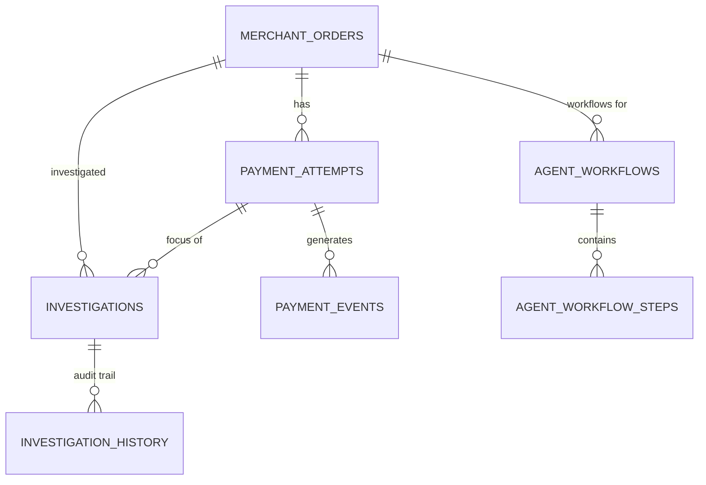

# RetryGuard AI — Database Design

## 1. Overview

**Database:** PostgreSQL 14+ (development uses PostgreSQL 18)  
**ORM:** Spring Data JPA / Hibernate 7.4.5  
**DDL Strategy:** `spring.jpa.hibernate.ddl-auto=validate` — application validates schema at startup; does **not** create or modify tables.  
**Migrations:** Additive SQL scripts (V1–V5) in `src/main/resources/db/migration/` applied manually via `psql`. No Flyway/Liquibase runner.

---

## 2. Entity-Relationship Diagram



---

## 3. Tables & Columns

### 3.1 `merchant_orders`

| Column | Type | Constraints | Description |
|--------|------|-------------|-------------|
| `id` | UUID | PK, `DEFAULT gen_random_uuid()` | Surrogate key |
| `merchant_order_reference` | VARCHAR(100) | NOT NULL, UNIQUE | Business-facing order reference |
| `amount` | NUMERIC(12,2) | NOT NULL | Order amount |
| `currency` | CHAR(3) | NOT NULL | ISO-4217 currency code |
| `order_status` | VARCHAR(30) | NOT NULL | Enum: `CREATED`, `PENDING`, `PAID`, `FAILED`, `CANCELLED` |
| `created_at` | TIMESTAMPTZ | NOT NULL, `DEFAULT now()` | Creation timestamp |
| `updated_at` | TIMESTAMPTZ | NOT NULL, `DEFAULT now()` | Last update timestamp |

**Indexes:**
- PK on `id`
- UNIQUE on `merchant_order_reference`

**JPA Entity:** `MerchantOrder`  
**Repository:** `MerchantOrderRepository`

---

### 3.2 `payment_attempts`

| Column | Type | Constraints | Description |
|--------|------|-------------|-------------|
| `id` | UUID | PK, `DEFAULT gen_random_uuid()` | Surrogate key |
| `order_id` | UUID | NOT NULL, FK → `merchant_orders(id)` | Owning order |
| `provider` | VARCHAR(30) | NOT NULL | Currently only `PAYPAL_SANDBOX` |
| `provider_payment_reference` | VARCHAR(150) | NULLABLE | PayPal order ID (from create order) |
| `provider_capture_reference` | VARCHAR(150) | NULLABLE | PayPal capture ID (from capture/webhook) |
| `provider_status` | VARCHAR(30) | NULLABLE | Provider-reported status (e.g., `COMPLETED`) |
| `amount` | NUMERIC(12,2) | NOT NULL | Attempt amount |
| `currency` | CHAR(3) | NOT NULL | ISO-4217 currency code |
| `payment_status` | VARCHAR(30) | NOT NULL | Enum: `CREATED`, `PENDING`, `SUCCEEDED`, `FAILED`, `CANCELLED`, `UNKNOWN` |
| `failure_code` | VARCHAR(100) | NULLABLE | Provider failure code |
| `failure_message` | TEXT | NULLABLE | Provider failure message |
| `created_at` | TIMESTAMPTZ | NOT NULL, `DEFAULT now()` | Creation timestamp |
| `updated_at` | TIMESTAMPTZ | NOT NULL, `DEFAULT now()` | Last update timestamp |

**Indexes:**
- PK on `id`
- FK on `order_id` → `merchant_orders(id)`
- Index on `order_id` (implicit from FK)

**JPA Entity:** `PaymentAttempt`  
**Repository:** `PaymentAttemptRepository`

**Notes:** `provider_capture_reference` and `provider_status` added by **V2** migration.

---

### 3.3 `payment_events`

| Column | Type | Constraints | Description |
|--------|------|-------------|-------------|
| `id` | UUID | PK, `DEFAULT gen_random_uuid()` | Surrogate key |
| `payment_attempt_id` | UUID | NULLABLE, FK → `payment_attempts(id)` | Associated attempt (may be null if unmatched) |
| `provider` | VARCHAR(30) | NOT NULL | Provider identifier (`PAYPAL_SANDBOX`, etc.) |
| `provider_event_id` | VARCHAR(200) | NULLABLE | Provider's event ID (for idempotency) |
| `event_type` | VARCHAR(100) | NOT NULL | PayPal event type (e.g., `PAYMENT.CAPTURE.COMPLETED`) |
| `source_type` | VARCHAR(20) | NOT NULL | Enum: `SIMULATED`, `PROVIDER` |
| `verification_status` | VARCHAR(20) | NOT NULL | Enum: `NOT_APPLICABLE`, `PENDING`, `VERIFIED`, `REJECTED` |
| `processing_status` | VARCHAR(20) | NOT NULL | Enum: `RECEIVED`, `PROCESSED`, `DUPLICATE`, `FAILED` |
| `payload` | JSONB | NOT NULL, `DEFAULT '{}'` | Full webhook/event payload |
| `received_at` | TIMESTAMPTZ | NOT NULL, `DEFAULT now()` | When event was received |
| `processed_at` | TIMESTAMPTZ | NULLABLE | When event was processed |

**Indexes:**
- PK on `id`
- FK on `payment_attempt_id` → `payment_attempts(id)`
- **Partial Unique Index (V1):** `uq_payment_events_provider_event_id` on `(provider, provider_event_id) WHERE provider_event_id IS NOT NULL`
- Index on `payment_attempt_id` (implicit from FK)

**JPA Entity:** `PaymentEvent`  
**Repository:** `PaymentEventRepository`

**JSONB Usage:** `payload` stores the complete raw webhook JSON. Queried via `jsonb_path_query` / `->>` in diagnostic tools.

---

### 3.4 `investigations`

| Column | Type | Constraints | Description |
|--------|------|-------------|-------------|
| `id` | UUID | PK, `DEFAULT gen_random_uuid()` | Surrogate key |
| `order_id` | UUID | NOT NULL, FK → `merchant_orders(id)` | Investigated order |
| `payment_attempt_id` | UUID | NULLABLE, FK → `payment_attempts(id)` | Focus attempt (optional) |
| `decision` | VARCHAR(30) | NOT NULL | Enum: `WAIT`, `RECONCILE`, `RETRY_ELIGIBLE` |
| `decision_reason` | TEXT | NOT NULL | Reason code (e.g., `ALL_ATTEMPTS_FRESHLY_DENIED`) |
| `evidence_snapshot` | JSONB | NOT NULL, `DEFAULT '{}'` | Snapshot of attempts & events at investigation time |
| `findings` | JSONB | NOT NULL, `DEFAULT '[]'` | Array of `AutopsyFinding` objects |
| `rules_version` | VARCHAR(30) | NOT NULL, `DEFAULT '1.0'` | Rules engine version |
| `explanation` | TEXT | NULLABLE | Deterministic explanation text (from `InvestigationExplanationService`) |
| `created_at` | TIMESTAMPTZ | NOT NULL, `DEFAULT now()` | Investigation timestamp |

**Indexes:**
- PK on `id`
- FK on `order_id` → `merchant_orders(id)`
- FK on `payment_attempt_id` → `payment_attempts(id)`
- Index on `order_id`, `created_at DESC` (for `findTop50ByOrder_IdOrderByCreatedAtDescIdDesc`)

**JPA Entity:** `Investigation`  
**Repository:** `InvestigationRepository`

**JSONB Usage:**
- `evidence_snapshot`: Serialized `EvidenceSnapshot` (order status, freshness threshold, attempt evidence list)
- `findings`: Array of `AutopsyFinding` (code, title, severity, rootCauseCategory, rootCauseUncertain, evidence refs, action)

**Notes:** `findings` column added by **V3** migration.

---

### 3.5 `investigation_history`

| Column | Type | Constraints | Description |
|--------|------|-------------|-------------|
| `id` | UUID | PK, `DEFAULT gen_random_uuid()` | Surrogate key |
| `investigation_id` | UUID | NOT NULL, FK → `investigations(id)` | Parent investigation |
| `action` | VARCHAR(50) | NOT NULL | Always `CREATED` (append-only) |
| `previous_decision` | VARCHAR(30) | NULLABLE | Previous decision (null for first) |
| `new_decision` | VARCHAR(30) | NOT NULL | New decision |
| `reason` | TEXT | NOT NULL | Reason for transition |
| `created_at` | TIMESTAMPTZ | NOT NULL, `DEFAULT now()` | Transition timestamp |

**Indexes:**
- PK on `id`
- FK on `investigation_id` → `investigations(id)`
- Index on `investigation_id`, `created_at ASC` (for `findByInvestigation_IdOrderByCreatedAtAscIdAsc`)

**JPA Entity:** `InvestigationHistory`  
**Repository:** `InvestigationHistoryRepository`

---

### 3.6 `agent_workflows`

| Column | Type | Constraints | Description |
|--------|------|-------------|-------------|
| `id` | UUID | PK, `DEFAULT gen_random_uuid()` | Surrogate key |
| `order_id` | UUID | NOT NULL, FK → `merchant_orders(id)` | Investigated order |
| `status` | VARCHAR(50) | NOT NULL | `RUNNING`, `COMPLETED`, `SKIPPED`, `ERROR`, `RECONCILED`, `WAITING_FOR_WEBHOOK`, `ESCALATED`, `WAITING_FOR_EVIDENCE`, `PROVIDER_UNAVAILABLE`, `BUDGET_EXCEEDED`, `INVALID_TOOL`, `TOOL_ERROR`, `INVALID_RESPONSE`, `FAILED` |
| `summary` | TEXT | NULLABLE | Human-readable summary / recommendation |
| `tool_calls_used` | INT | NOT NULL, `DEFAULT 0` | Count of tool calls executed |
| `model_turns_used` | INT | NOT NULL, `DEFAULT 0` | Count of model turns |
| `provider_name` | VARCHAR(50) | NULLABLE | `GROQ` |
| `model_name` | VARCHAR(100) | NULLABLE | Groq model (e.g., `openai/gpt-oss-120b`) |
| `prompt_tokens` | INT | NULLABLE | Prompt tokens used |
| `completion_tokens` | INT | NULLABLE | Completion tokens used |
| `total_tokens` | INT | NULLABLE | Total tokens used |
| `started_at` | TIMESTAMPTZ | NOT NULL, `DEFAULT now()` | Workflow start time |
| `completed_at` | TIMESTAMPTZ | NULLABLE | Workflow completion time |
| `created_at` | TIMESTAMPTZ | NOT NULL, `DEFAULT now()` | Record creation time |

**Indexes:**
- PK on `id`
- FK on `order_id` → `merchant_orders(id)`
- Index on `order_id` (V4): `idx_agent_workflows_order_id`
- Index on `started_at DESC` (V4): `idx_agent_workflows_started_at`
- **Partial Unique Index (V5):** `uq_agent_workflows_one_running_per_order` on `order_id WHERE status = 'RUNNING'`

**JPA Entity:** `AgentWorkflow`  
**Repository:** `AgentWorkflowRepository` (custom: `findRunningByOrderId`, `findByOrderIdOrderByStartedAtDesc`, `findTop50ByOrderByStartedAtDesc`)

---

### 3.7 `agent_workflow_steps`

| Column | Type | Constraints | Description |
|--------|------|-------------|-------------|
| `id` | UUID | PK, `DEFAULT gen_random_uuid()` | Surrogate key |
| `workflow_id` | UUID | NOT NULL, FK → `agent_workflows(id) ON DELETE CASCADE` | Parent workflow |
| `step_type` | VARCHAR(50) | NOT NULL | `TOOL_CALL`, `RECOMMENDATION`, `MODEL_RESPONSE`, `ERROR` |
| `step_name` | VARCHAR(100) | NOT NULL | Tool name or step identifier |
| `input_summary` | JSONB | NULLABLE | Serialized tool input arguments |
| `output_summary` | JSONB | NULLABLE | Serialized tool output / result |
| `error` | TEXT | NULLABLE | Error message if step failed |
| `created_at` | TIMESTAMPTZ | NOT NULL, `DEFAULT now()` | Step timestamp |

**Indexes:**
- PK on `id`
- FK on `workflow_id` → `agent_workflows(id)` (ON DELETE CASCADE)
- Index on `workflow_id` (V4): `idx_agent_workflow_steps_workflow_id`
- Index on `created_at ASC` (V4): `idx_agent_workflow_steps_created_at`

**JPA Entity:** `AgentWorkflowStep`  
**Repository:** `AgentWorkflowStepRepository` (custom: `findByWorkflowIdOrderByCreatedAtAsc`)

**JSONB Usage:** `input_summary` and `output_summary` store serialized tool arguments/results for audit/debugging.

---

## 4. Migration Scripts (V1–V5)

All scripts are **additive** (`IF NOT EXISTS` / `ADD COLUMN IF NOT EXISTS`) and idempotent. They must be applied in order to a database that already has the base schema (tables created by Hibernate `ddl-auto: validate` expects tables to exist).

### V1: `V1__payment_event_idempotency.sql`

```sql
CREATE UNIQUE INDEX IF NOT EXISTS uq_payment_events_provider_event_id
    ON payment_events (provider, provider_event_id)
    WHERE provider_event_id IS NOT NULL;
```

**Purpose:** Enforce idempotent webhook processing. Prevents duplicate `PaymentEvent` rows for the same `(provider, provider_event_id)` pair.

**Applied to:** `payment_events` table.

**Verification:** `INSERT` with duplicate `(provider, provider_event_id)` → `PSQLException` (unique violation) → caught in `PaypalWebhookEventProcessor` → returns `DUPLICATE` state.

---

### V2: `V2__paypal_payment_references.sql`

```sql
ALTER TABLE payment_attempts
    ADD COLUMN IF NOT EXISTS provider_capture_reference VARCHAR(150),
    ADD COLUMN IF NOT EXISTS provider_status VARCHAR(30);
```

**Purpose:** Add PayPal-specific capture reference and provider status columns to `payment_attempts`.

**Applied to:** `payment_attempts` table.

**Verification:** Columns exist; `PaymentAttempt` entity maps them.

---

### V3: `V3__investigation_findings.sql`

```sql
ALTER TABLE investigations
    ADD COLUMN IF NOT EXISTS findings JSONB NOT NULL DEFAULT '[]'::jsonb;
```

**Purpose:** Add `findings` column to store `AutopsyFinding[]` as JSONB.

**Applied to:** `investigations` table.

**Verification:** Column exists with default `[]`; `Investigation` entity maps it.

---

### V4: `V4__agent_workflows.sql`

```sql
-- Agent workflows table
CREATE TABLE IF NOT EXISTS agent_workflows (
    id UUID PRIMARY KEY DEFAULT gen_random_uuid(),
    order_id UUID NOT NULL REFERENCES merchant_orders(id),
    status VARCHAR(50) NOT NULL,
    summary TEXT,
    tool_calls_used INT NOT NULL DEFAULT 0,
    model_turns_used INT NOT NULL DEFAULT 0,
    provider_name VARCHAR(50),
    model_name VARCHAR(100),
    prompt_tokens INT,
    completion_tokens INT,
    total_tokens INT,
    started_at TIMESTAMPTZ NOT NULL DEFAULT now(),
    completed_at TIMESTAMPTZ,
    created_at TIMESTAMPTZ NOT NULL DEFAULT now()
);

CREATE INDEX IF NOT EXISTS idx_agent_workflows_order_id ON agent_workflows(order_id);
CREATE INDEX IF NOT EXISTS idx_agent_workflows_started_at ON agent_workflows(started_at DESC);

-- Agent workflow steps table
CREATE TABLE IF NOT EXISTS agent_workflow_steps (
    id UUID PRIMARY KEY DEFAULT gen_random_uuid(),
    workflow_id UUID NOT NULL REFERENCES agent_workflows(id) ON DELETE CASCADE,
    step_type VARCHAR(50) NOT NULL,
    step_name VARCHAR(100) NOT NULL,
    input_summary JSONB,
    output_summary JSONB,
    error TEXT,
    created_at TIMESTAMPTZ NOT NULL DEFAULT now()
);

CREATE INDEX IF NOT EXISTS idx_agent_workflow_steps_workflow_id ON agent_workflow_steps(workflow_id);
CREATE INDEX IF NOT EXISTS idx_agent_workflow_steps_created_at ON agent_workflow_steps(created_at ASC);
```

**Purpose:** Create agent workflow persistence tables with indexes.

**Applied to:** Creates `agent_workflows` and `agent_workflow_steps` tables.

**Verification:** Tables exist; entities map; repositories work; indexes visible in `\d`.

---

### V5: `V5__concurrent_workflow_prevention.sql`

```sql
CREATE UNIQUE INDEX IF NOT EXISTS uq_agent_workflows_one_running_per_order
    ON agent_workflows (order_id)
    WHERE status = 'RUNNING';
```

**Purpose:** Enforce at most one `RUNNING` workflow per `order_id` at the database level.

**Applied to:** `agent_workflows` table.

**Verification:**
- Two concurrent `INSERT`s with same `order_id` and `status='RUNNING'` → second fails with unique violation on `uq_agent_workflows_one_running_per_order`.
- `AgentWorkflowService.isWorkflowConcurrencyViolation()` catches this and returns `SKIPPED · WORKFLOW_ALREADY_RUNNING`.
- Different orders can have `RUNNING` workflows simultaneously.
- After a workflow reaches terminal status (`COMPLETED`, `ERROR`, `SKIPPED`, etc.), a new `RUNNING` workflow for the same order is allowed.

---

## 5. Manual Migration Application Procedure

```powershell
# 1. Ensure PostgreSQL is running and database exists
psql -h localhost -U postgres -c "CREATE DATABASE retryguard_db;"

# 2. Apply base schema (Hibernate will validate against this)
#    The base tables (merchant_orders, payment_attempts, payment_events, investigations)
#    are created by Hibernate on first run if they don't exist, but ddl-auto=validate
#    means they must exist before startup. Create them via:
psql -h localhost -U postgres -d retryguard_db -c "
CREATE EXTENSION IF NOT EXISTS "uuid-ossp";
CREATE EXTENSION IF NOT EXISTS "pgcrypto";
-- Base tables created by Hibernate or manual DDL matching entities
"

# 3. Apply additive migrations in order
psql -v ON_ERROR_STOP=1 -h localhost -U postgres -d retryguard_db -f src/main/resources/db/migration/V1__payment_event_idempotency.sql
psql -v ON_ERROR_STOP=1 -h localhost -U postgres -d retryguard_db -f src/main/resources/db/migration/V2__paypal_payment_references.sql
psql -v ON_ERROR_STOP=1 -h localhost -U postgres -d retryguard_db -f src/main/resources/db/migration/V3__investigation_findings.sql
psql -v ON_ERROR_STOP=1 -h localhost -U postgres -d retryguard_db -f src/main/resources/db/migration/V4__agent_workflows.sql
psql -v ON_ERROR_STOP=1 -h localhost -U postgres -d retryguard_db -f src/main/resources/db/migration/V5__concurrent_workflow_prevention.sql

# 4. Optional: Create restricted runtime role
psql -v ON_ERROR_STOP=1 -h localhost -U postgres -d retryguard_db -f src/main/resources/db/security/retryguard_app.sql
```

**Important:** There is **no automatic migration runner**. The presence of a migration file does not prove it was applied — always inspect the actual schema (`\d table_name`, `\di index_name`).

---

## 6. JSONB Column Details

| Table | Column | Structure | Example |
|-------|--------|-----------|---------|
| `payment_events` | `payload` | Raw PayPal webhook JSON | `{"id":"WH-123","event_type":"PAYMENT.CAPTURE.COMPLETED","resource":{"id":"CAP-456","amount":{"value":"25.00","currency_code":"USD"},...}}` |
| `investigations` | `evidence_snapshot` | `EvidenceSnapshot` record | `{"orderStatus":"PENDING","investigationTime":"2024-01-15T10:30:00Z","freshnessThresholdMinutes":15,"attempts":[...]}` |
| `investigations` | `findings` | Array of `AutopsyFinding` | `[{"code":"PROVIDER_DENIAL","title":"PayPal denied capture","severity":"HIGH","rootCauseCategory":"PROVIDER_DECLINE","rootCauseUncertain":false,"evidence":[{"type":"PAYMENT_EVENT","id":"..."}],"action":"Wait for fresh denial evidence"}]` |
| `agent_workflow_steps` | `input_summary` | Tool call arguments | `{"attemptId":"uuid","orderId":"uuid"}` |
| `agent_workflow_steps` | `output_summary` | Tool call result | `{"httpStatus":200,"paypalOrderStatus":"COMPLETED","paypalCaptureAmount":"25.00",...}` |

---

## 7. Key Constraints Summary

| Constraint | Tables | Purpose |
|------------|--------|---------|
| PK `merchant_orders(id)` | `merchant_orders` | Surrogate key |
| UK `merchant_order_reference` | `merchant_orders` | Business key uniqueness |
| FK `payment_attempts.order_id` | `payment_attempts` → `merchant_orders` | Referential integrity |
| PK `payment_attempts(id)` | `payment_attempts` | Surrogate key |
| UK partial `(provider, provider_event_id)` | `payment_events` | Webhook idempotency (V1) |
| FK `payment_events.payment_attempt_id` | `payment_events` → `payment_attempts` | Link events to attempts |
| PK `payment_events(id)` | `payment_events` | Surrogate key |
| FK `investigations.order_id` | `investigations` → `merchant_orders` | Link investigation to order |
| FK `investigations.payment_attempt_id` | `investigations` → `payment_attempts` | Optional focus attempt |
| PK `investigations(id)` | `investigations` | Surrogate key |
| FK `investigation_history.investigation_id` | `investigation_history` → `investigations` | Audit trail linkage |
| PK `investigation_history(id)` | `investigation_history` | Surrogate key |
| FK `agent_workflows.order_id` | `agent_workflows` → `merchant_orders` | Link workflow to order |
| PK `agent_workflows(id)` | `agent_workflows` | Surrogate key |
| UK partial `status='RUNNING'` on `order_id` | `agent_workflows` | Concurrency control (V5) |
| FK `agent_workflow_steps.workflow_id` | `agent_workflow_steps` → `agent_workflows` (CASCADE) | Step ownership |
| PK `agent_workflow_steps(id)` | `agent_workflow_steps` | Surrogate key |

---

## 8. Index Inventory

| Index | Table | Columns | Type | Source |
|-------|-------|---------|------|--------|
| `merchant_orders_pkey` | `merchant_orders` | `id` | PK | Base |
| `merchant_orders_merchant_order_reference_key` | `merchant_orders` | `merchant_order_reference` | UNIQUE | Base |
| `payment_attempts_pkey` | `payment_attempts` | `id` | PK | Base |
| `payment_attempts_order_id_fkey` | `payment_attempts` | `order_id` | FK | Base |
| `uq_payment_events_provider_event_id` | `payment_events` | `provider, provider_event_id` | PARTIAL UNIQUE | V1 |
| `payment_events_pkey` | `payment_events` | `id` | PK | Base |
| `payment_events_payment_attempt_id_fkey` | `payment_events` | `payment_attempt_id` | FK | Base |
| `investigations_pkey` | `investigations` | `id` | PK | Base |
| `investigations_order_id_fkey` | `investigations` | `order_id` | FK | Base |
| `investigations_payment_attempt_id_fkey` | `investigations` | `payment_attempt_id` | FK | Base |
| `investigation_history_pkey` | `investigation_history` | `id` | PK | Base |
| `investigation_history_investigation_id_fkey` | `investigation_history` | `investigation_id` | FK | Base |
| `agent_workflows_pkey` | `agent_workflows` | `id` | PK | V4 |
| `agent_workflows_order_id_fkey` | `agent_workflows` | `order_id` | FK | V4 |
| `idx_agent_workflows_order_id` | `agent_workflows` | `order_id` | INDEX | V4 |
| `idx_agent_workflows_started_at` | `agent_workflows` | `started_at DESC` | INDEX | V4 |
| `uq_agent_workflows_one_running_per_order` | `agent_workflows` | `order_id` | PARTIAL UNIQUE | V5 |
| `agent_workflow_steps_pkey` | `agent_workflow_steps` | `id` | PK | V4 |
| `agent_workflow_steps_workflow_id_fkey` | `agent_workflow_steps` | `workflow_id` | FK (CASCADE) | V4 |
| `idx_agent_workflow_steps_workflow_id` | `agent_workflow_steps` | `workflow_id` | INDEX | V4 |
| `idx_agent_workflow_steps_created_at` | `agent_workflow_steps` | `created_at ASC` | INDEX | V4 |

---

*This database design reflects the actual schema as defined by JPA entities and V1–V5 migration scripts. All constraints and indexes are verified in the source code and migration files.*