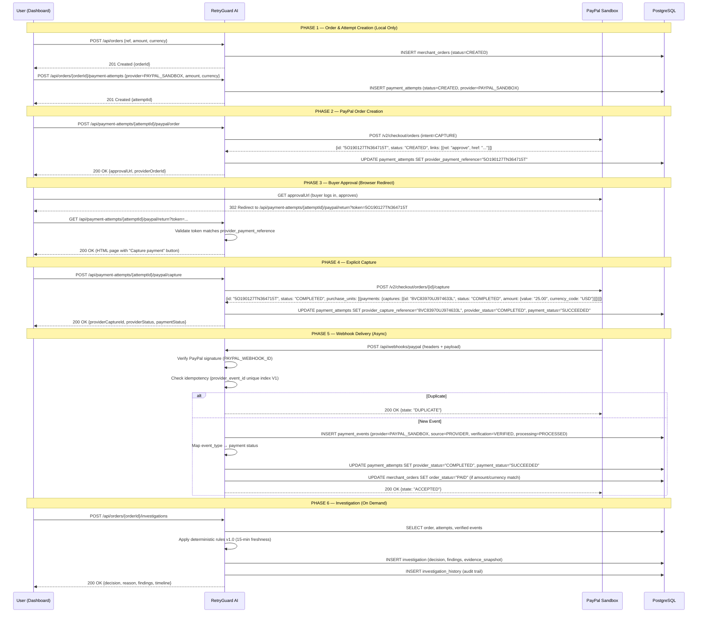
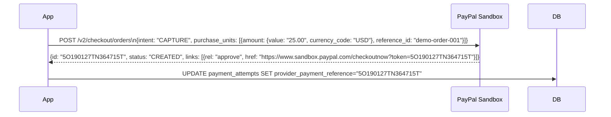
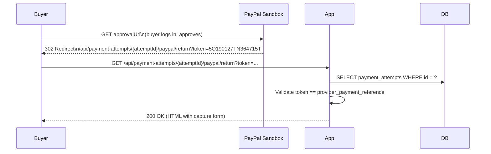
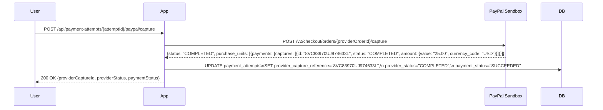
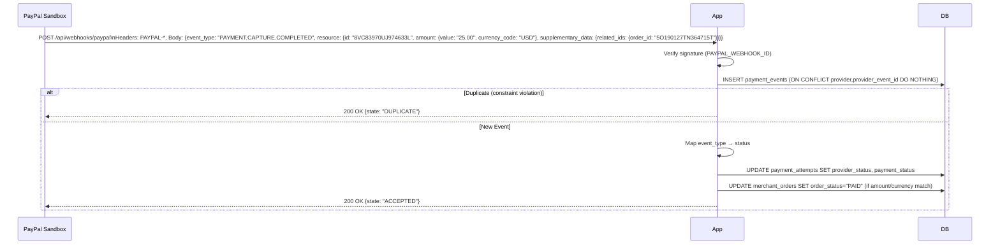
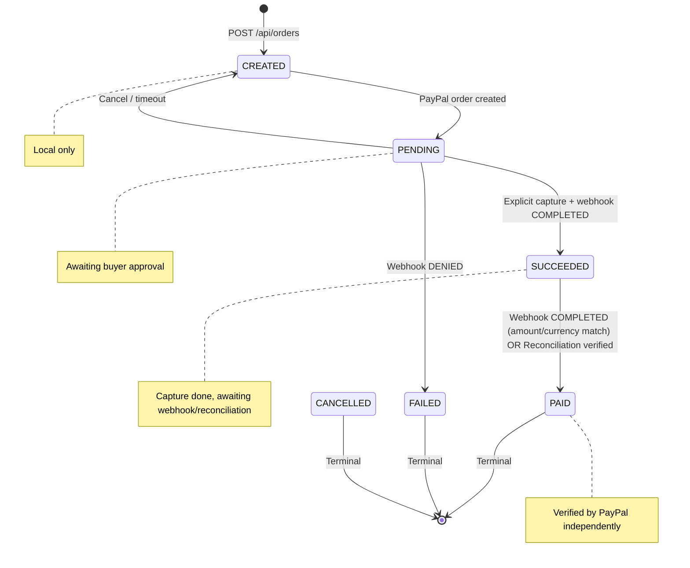
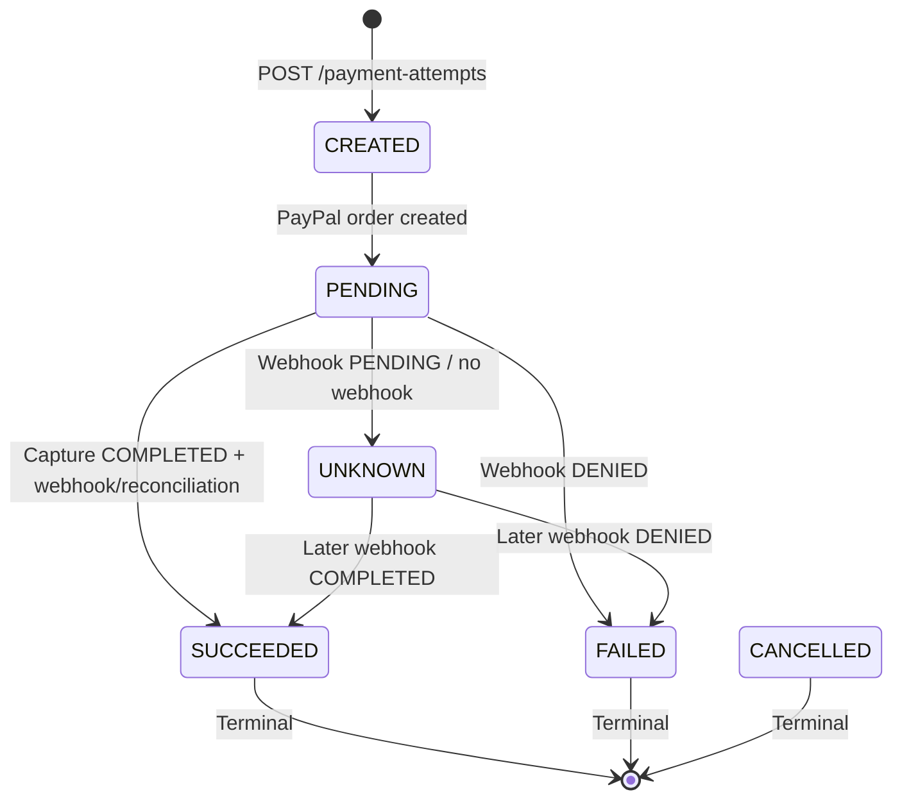

# RetryGuard AI — Payment Workflow

## 1. Overview

This document describes the complete PayPal Sandbox payment lifecycle as implemented in RetryGuard AI, from merchant order creation through PayPal approval, capture, webhook processing, provider verification, reconciliation, and investigation.

**Key Principle:** Approval ≠ Payment. Capture is an explicit, separate action. Webhook is verified before any state change. Reconciliation independently re-verifies PayPal before marking `PAID`.

---

## 2. Payment Lifecycle Sequence



---

## 3. Detailed Phase Descriptions

### Phase 1: Local Order & Attempt Creation

| Step | API | Database Action | Notes |
|------|-----|-----------------|-------|
| 1.1 | `POST /api/orders` | `INSERT merchant_orders` (status=CREATED) | No payment initiated; purely local tracking |
| 1.2 | `POST /api/orders/{id}/payment-attempts` | `INSERT payment_attempts` (status=CREATED, provider=PAYPAL_SANDBOX) | Links to order; amount/currency must match order |

**Security:** Both require auth + CSRF.  
**Validation:** Unique merchant reference; positive amount; valid ISO currency.

---

### Phase 2: PayPal Sandbox Order Creation



**Implementation:** `PaypalPaymentService.createOrder()` → `PaypalClient.createOrder()`  
**Stored:** `provider_payment_reference` (PayPal order ID)  
**Returned:** `approvalUrl` for buyer redirect

---

### Phase 3: Buyer Approval (Browser Redirect)



**Validation:** `PaypalPaymentService.validateReturn(attemptId, token)`  
**Public Endpoint:** No auth required (browser redirect from PayPal)  
**CSRF:** Not applicable (GET)  
**Result:** HTML page with explicit "Capture payment" button — **approval does not confirm payment**

---

### Phase 4: Explicit Capture



**Key Points:**
- **Explicit action** — user must click "Capture payment" button
- **Capture ≠ Approval** — approval only permits capture
- **Local state updated** — attempt status → SUCCEEDED, capture reference stored
- **Order NOT yet PAID** — waits for webhook or reconciliation

---

### Phase 5: Webhook Processing



#### Webhook Event Mapping

| PayPal Event Type | PaymentAttempt Status | MerchantOrder Status (if match) |
|-------------------|----------------------|----------------------------------|
| `PAYMENT.CAPTURE.COMPLETED` | `SUCCEEDED` | `PAID` (amount + currency must match attempt) |
| `PAYMENT.CAPTURE.PENDING` | `PENDING` | Unchanged |
| `PAYMENT.CAPTURE.DENIED` | `FAILED` | Unchanged (or `FAILED` if all attempts failed) |
| `PAYMENT.CAPTURE.REFUNDED` | `FAILED` | Unchanged |
| Other | `RECEIVED` only | Unchanged |

#### Idempotency (V1 Migration)

```sql
CREATE UNIQUE INDEX IF NOT EXISTS uq_payment_events_provider_event_id
    ON payment_events (provider, provider_event_id)
    WHERE provider_event_id IS NOT NULL;
```

- Duplicate delivery → unique constraint violation → caught → returns `DUPLICATE`
- No duplicate `PaymentEvent` rows; no double-processing

#### Signature Verification

- Mandatory for every webhook request
- Uses `PAYPAL_WEBHOOK_ID` from environment
- Invalid signature → `REJECTED` processing status → no state changes

---

### Phase 6: Investigation (Payment Autopsy)

```mermaid
flowchart TD
    Start([POST /api/orders/{id}/investigations]) --> Load["Load order, attempts, verified events"]
    Load --> Evidence["Build evidence snapshots\n(trusted = PAYPAL_SANDBOX + PROVIDER + VERIFIED)"]
    Evidence --> Rules["Apply Rules v1.0\n(Freshness: 15 min)"]
    Rules --> Decision{Decision}
    Decision -->|All failed attempts have fresh verified denials| RETRY["RETRY_ELIGIBLE\nReason: ALL_ATTEMPTS_FRESHLY_DENIED"]
    Decision -->|Verified outcomes conflict| RECONCILE["RECONCILE\nReason: CONFLICTING_PAYMENT_EVIDENCE"]
    Decision -->|Any uncertainty, pending, stale, confirmed payment| WAIT["WAIT\nReason: INSUFFICIENT_OR_STALE_EVIDENCE / PAYMENT_CONFIRMED / MERCHANT_ORDER_PENDING"]
    RETRY --> Persist["Persist Investigation + History"]
    RECONCILE --> Persist
    WAIT --> Persist
    Persist --> Return([Return InvestigationResponse])
```

#### Finding Codes & Meanings

| Code | When Generated | Severity | Action Guidance |
|------|----------------|----------|-----------------|
| `PROVIDER_DENIAL` | Fresh verified denial exists | HIGH | Wait for fresh denial evidence before retry |
| `PENDING_PAYMENT` | Verified PENDING event | MEDIUM | Wait for terminal outcome |
| `CONFLICTING_OUTCOMES` | Verified denial + completion for different captures | HIGH | Reconcile before any recovery |
| `STALE_EVIDENCE` | Trusted evidence > 15 min old | MEDIUM | Wait for fresh evidence |
| `UNVERIFIED_EVIDENCE` | Only simulated/unverified events | LOW | Do not act on unverified data |
| `MISSING_EVIDENCE` | No events for a failed attempt | MEDIUM | Investigate provider side |
| `PAYMENT_CONFIRMED` | Verified COMPLETED event exists | INFO | No retry indicated |

---

## 4. Reconciliation Safety Gate

**Triggered by:** Agent recommendation `RECONCILE_LOCAL_ORDER` or manual invocation  
**Implemented in:** `ReconciliationSafetyService.reconcileIfAuthorized(orderId, attemptId)`

### Verification Checklist (All Must Pass)

1. ✅ Order exists
2. ✅ Payment attempt exists
3. ✅ Attempt belongs to order
4. ✅ Provider = `PAYPAL_SANDBOX`
5. ✅ Provider order reference exists
6. ✅ PayPal diagnostic HTTP 200
7. ✅ PayPal order status = `COMPLETED`
8. ✅ PayPal order intent = `CAPTURE`
9. ✅ Purchase unit exists matching merchant order reference
10. ✅ Purchase unit reference matches merchant reference
11. ✅ Actual capture record exists
12. ✅ Capture status = `COMPLETED`
13. ✅ Capture amount = local attempt amount
14. ✅ Capture currency = local attempt currency
15. ✅ If local capture reference exists, matches PayPal capture ID
16. ✅ No ambiguity (multiple captures with same reference → reject)

### On Success

```java
order.setOrderStatus(MerchantOrder.OrderStatus.PAID);
orderRepository.save(order);

attempt.setPaymentStatus(PaymentAttempt.PaymentStatus.SUCCEEDED);
attempt.setProviderStatus("COMPLETED");
attemptRepository.save(attempt);
```

### On Failure

Returns `ReconciliationResult.failure(code, message)` — no state changes.  
Agent workflow status → `ESCALATED` with failure reason.

---

## 5. Status Transition Diagram



### PaymentAttempt Status Transitions



---

## 6. Dashboard Walkthrough (Payment Flow)

| Step | Dashboard Action | API Call | Expected Result |
|------|------------------|----------|-----------------|
| 1 | Enter merchant reference, amount, currency → "Create order" | `POST /api/orders` | Order appears in list with status `CREATED` |
| 2 | Select order → "Create attempt" | `POST /api/orders/{id}/payment-attempts` | Attempt appears in dropdown |
| 3 | Select attempt → "Create Sandbox order" | `POST /paypal/order` | Approval link shown; attempt gets `providerPaymentReference` |
| 4 | Click "Open PayPal approval" → approve in Sandbox buyer account | Browser redirect to PayPal | Returns to dashboard with "Capture payment" button |
| 5 | Click "Capture Sandbox payment" → confirm | `POST /paypal/capture` | Capture response shows `COMPLETED`; attempt status → `SUCCEEDED` |
| 6 | (Webhook delivered automatically) | `POST /webhooks/paypal` | Order status → `PAID` (if amount/currency match) |
| 7 | Click "Payment timeline" | `GET /orders/{id}/timeline` | Chronological view of all events |
| 8 | Click "Run investigation" | `POST /orders/{id}/investigations` | Deterministic decision + findings |
| 9 | Click "Explain decision" | `POST /investigations/{id}/explanation` | Plain-language deterministic summary |

---

## 7. Edge Cases & Handling

| Scenario | Behavior |
|----------|----------|
| **Capture succeeds, webhook delayed** | Investigation shows `WAIT` (missing evidence); agent recommends `WAIT_FOR_WEBHOOK`; reconciliation available via `RECONCILE_LOCAL_ORDER` |
| **Webhook arrives before capture** | Webhook `PENDING` → attempt status `PENDING`; later capture + `COMPLETED` webhook → `PAID` |
| **Duplicate webhook delivery** | Idempotency index (V1) catches duplicate → returns `DUPLICATE` → no double processing |
| **Capture DENIED** | Attempt → `FAILED`; investigation → `RETRY_ELIGIBLE` if fresh denial; `WAIT` if stale |
| **Amount/currency mismatch on webhook** | Order NOT marked `PAID`; investigation → `RECONCILE` (conflicting evidence) |
| **Invalid webhook signature** | Event stored with `verification_status=REJECTED`; no state changes |
| **Missing webhook entirely** | Manual reconciliation via agent `RECONCILE_LOCAL_ORDER` or dashboard investigation |
| **Buyer cancels on PayPal** | Redirect to `/paypal/cancel`; no capture; attempt stays `CREATED`/`PENDING` |

---

## 8. Key Invariants (Always True)

1. **No order becomes `PAID` without independent PayPal verification** (webhook verified COMPLETED + match, OR reconciliation service verified capture)
2. **Capture is always explicit** — no automatic capture on approval
3. **Webhook processing is idempotent** — duplicate deliveries safe
4. **Evidence freshness is 15 minutes** — stale evidence doesn't authorize retry
5. **Conflicting evidence → RECONCILE** — never RETRY_ELIGIBLE
6. **Confirmed payment → WAIT** — never RETRY_ELIGIBLE
7. **All state changes audited** — `InvestigationHistory`, `PaymentEvent.processing_status`, `AgentWorkflow` steps

---

*This payment workflow reflects the actual implemented behavior in `PaypalPaymentService`, `PaypalWebhookService`, `ReconciliationSafetyService`, `InvestigationService`, and the dashboard JavaScript. All flows have unit test coverage; end-to-end Sandbox validation is manual (see TESTING.md).*