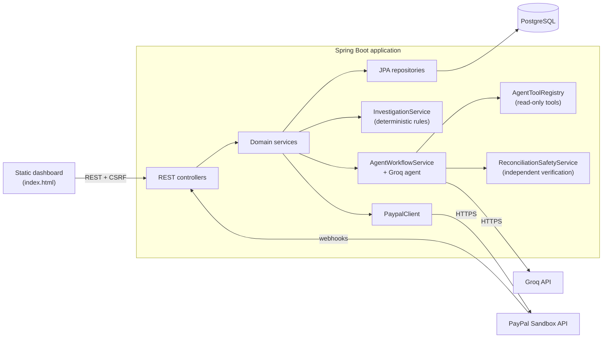
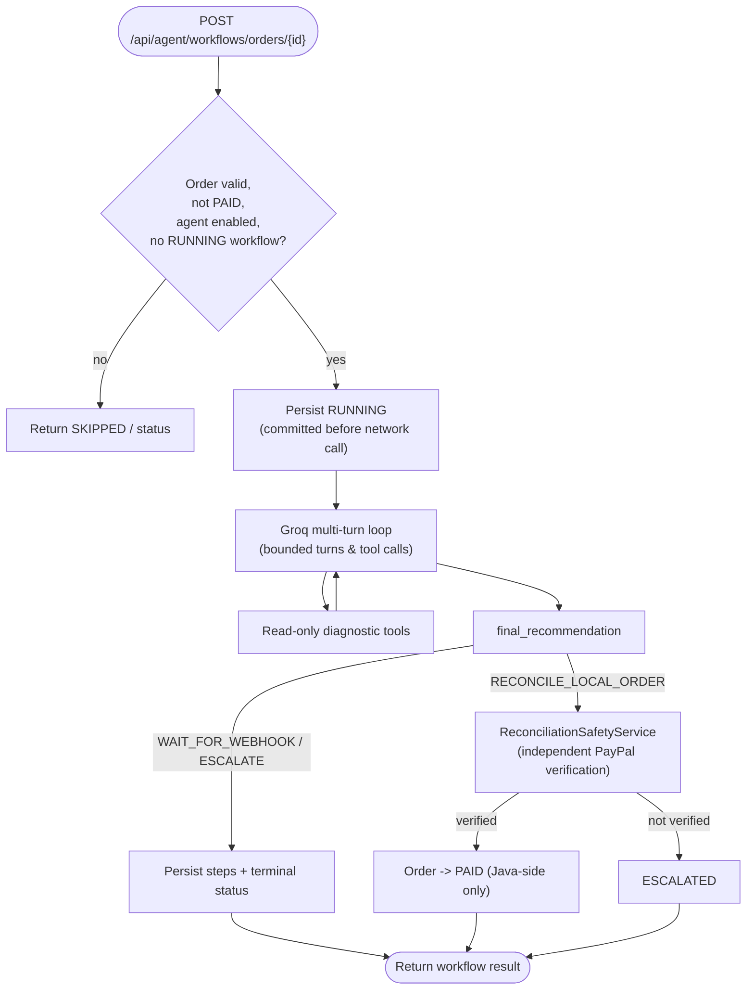

# RetryGuard AI

**Payment Autopsy Console** — a Spring Boot application that reconstructs what happened to a payment and produces a conservative, evidence-based verdict. It records merchant orders and PayPal Sandbox payment attempts, ingests signature-verified PayPal webhooks, runs a deterministic "Payment Autopsy" investigation, and offers an advisory AI agent (Groq) that can only read diagnostic data — never move money.

> **Scope:** This project is currently demonstrated **locally** against the **PayPal Sandbox** environment. It is **not** production-deployed, and this README makes no production-readiness claim.

---

## 1. Overview & problem statement

When an online payment "fails," the truth is often ambiguous: the buyer may have been charged while the merchant order still looks unpaid, a webhook may arrive late, provider and local records may disagree, or the evidence may simply be incomplete. Blindly retrying in these situations risks **double charges**; blindly marking orders paid risks **revenue loss and fraud**.

RetryGuard AI treats each incident like a post-mortem ("autopsy"). It gathers the available evidence, applies **deterministic, conservative rules** to classify the situation, and records an auditable verdict with linked evidence. AI assistance is strictly advisory and read-only: a Groq agent can gather and summarize diagnostics and suggest a next step, but a separate Java safety service independently re-verifies the provider before any local payment state is ever changed.

**Core principles**

- Deterministic rules are the authority for every payment decision.
- The AI agent cannot authorize, execute, retry, capture, or refund a payment.
- No order is marked `PAID` without independent, Java-side PayPal verification.
- Uncertain or conflicting evidence never triggers a retry.

---

## 2. Key features

- **Merchant order & payment-attempt tracking** — local records only; creating them never charges a buyer.
- **PayPal Sandbox checkout** — create order, buyer approval redirect, explicit capture, return/cancel handling.
- **Signature-verified webhooks** — mandatory PayPal signature verification with idempotent, duplicate-safe processing.
- **Payment timeline reconstruction** — a chronological view of orders, attempts, and verified events.
- **Deterministic Payment Autopsy** — conservative decision engine with evidence-linked findings and audit history.
- **Deterministic decision explanation** — a plain-language, non-authoritative summary of an investigation's decision and findings.
- **Groq agentic workflow** — multi-turn, allowlisted, read-only diagnostic tools with bounded turns/tool-calls.
- **Java reconciliation safety gate** — independent PayPal capture-level verification before any state change.
- **Static dashboard** — a single-page console served by the application.
- **Security** — HTTP Basic + form login, CSRF protection, configurable CORS.

---

## 3. Technology stack

| Area | Technology |
|------|-----------|
| Language / runtime | Java 21 |
| Framework | Spring Boot 4.1.1 (Spring Web MVC, Spring Security 7.1.1) |
| Persistence | Spring Data JPA / Hibernate ORM 7.4.5, PostgreSQL |
| JSON | Jackson 3.x (`tools.jackson`); Jackson 2.x annotations in the Groq client |
| AI provider | Groq Chat Completions (OpenAI-compatible function calling) |
| API docs | springdoc-openapi 3.1.1 (Swagger UI) |
| Build | Maven (Maven Wrapper included) |
| Testing | JUnit 5, Mockito, Spring Security Test; Testcontainers is on the classpath |
| Frontend | Static HTML/CSS/JavaScript dashboard (no separate build step) |

---

## 4. System architecture overview

RetryGuard AI is a **modular monolith**. HTTP controllers delegate to services; services use Spring Data repositories; external calls (PayPal, Groq) go through dedicated clients. Deterministic investigation is the authority; AI is advisory.



**Key components**

| Concern | Classes |
|---------|---------|
| Orders / attempts / events | `MerchantOrderService`, `PaymentAttemptService`, `PaymentEventService` |
| Timeline | `PaymentTimelineService`, `InvestigationService` |
| Investigation (autopsy) | `InvestigationService`, `AutopsyFinding` |
| Deterministic explanation | `InvestigationExplanationService`, `InvestigationExplanationPersistenceService` |
| PayPal integration | `PaypalClient`, `PaypalPaymentService`, `PaypalWebhookService`, `PaypalWebhookEventProcessor` |
| Groq agent | `AgentWorkflowService`, `AgentOrchestrator`, `GroqAgentProvider`, `AgentToolRegistry` |
| Reconciliation safety | `ReconciliationSafetyService` |
| Security | `SecurityConfig`, `SecurityUserConfig` |

---

## 5. Payment Autopsy — decision engine

`InvestigationService` evaluates an order's attempts and verified events and records an `Investigation` with one decision, a reason code, and evidence-linked findings. Rules version `1.0`; evidence freshness window **15 minutes**. "Trusted" evidence means provider `PAYPAL_SANDBOX`, source `PROVIDER`, and verification status `VERIFIED`.

### Decision types

| Decision | Meaning |
|----------|---------|
| `RETRY_ELIGIBLE` | **Only** when every failed PayPal attempt has fresh, verified terminal-denial evidence with no later, untrusted, pending, completed, or unknown outcome. |
| `RECONCILE` | Verified outcomes conflict with each other or with the current order/payment status — reconcile before any recovery action. |
| `WAIT` | Any uncertain, pending, stale, incomplete, or confirmed-successful situation (a confirmed payment is never retry-eligible). |

### Finding codes (`AutopsyFinding.Code`)

`PROVIDER_DENIAL`, `PENDING_PAYMENT`, `CONFLICTING_OUTCOMES`, `STALE_EVIDENCE`, `UNVERIFIED_EVIDENCE`, `MISSING_EVIDENCE`, `PAYMENT_CONFIRMED`.

Each finding carries a severity (`INFO`/`LOW`/`MEDIUM`/`HIGH`), a root-cause category, a "root cause uncertain" flag, evidence references (`ORDER`/`PAYMENT_ATTEMPT`/`PAYMENT_EVENT` IDs), and operator guidance. **Findings are informational** — the engine never retries, captures, refunds, or charges.

### Decision explanation

`POST /api/investigations/{id}/explanation` returns a deterministic, human-readable summary of the decision, reason, rules version, and finding summary, always ending with a statement that it does not authorize a payment action. The response `source` is `DETERMINISTIC`. This explanation never changes the recorded decision.

---

## 6. Groq AI agent & safety boundaries

The agent (`AgentWorkflowService` → `AgentOrchestrator` → `GroqAgentProvider`) runs a bounded, multi-turn function-calling loop over an **allowlist of read-only tools**. It is **advisory only**.

### Available tools (`AgentToolRegistry`)

| Tool | Purpose |
|------|---------|
| `get_order_summary` | Local order details (status, amount, currency, timestamps). |
| `get_payment_attempts` | Attempts for the order; provider references are masked. |
| `get_verified_webhook_summary` | Verified PayPal webhook events only; raw payloads are never exposed. |
| `get_latest_investigation` | Latest deterministic investigation (decision, reason, findings). |
| `verify_paypal_capture` | Read-only PayPal order/capture diagnostic (local vs provider amounts/currency). |
| `final_recommendation` | Submits one of `RECONCILE_LOCAL_ORDER`, `WAIT_FOR_WEBHOOK`, `ESCALATE`. |

### Safety boundaries

- Bounded **model turns (5)** and **tool calls** (configurable, default `8`); unknown tool names, invalid inputs, and tool failures end the run safely.
- Tools are **read-only** and **order-scoped**; the agent cannot capture, refund, retry, or change payment/order status.
- A `RECONCILE_LOCAL_ORDER` recommendation does **not** change state directly. It only invokes `ReconciliationSafetyService`, which independently re-verifies PayPal (HTTP 200, order status `COMPLETED`, intent `CAPTURE`, purchase unit matched by merchant reference, amount **and** currency match on both purchase unit and actual capture, capture status `COMPLETED`, capture-ID match when stored, ambiguity rejected) before marking the order `PAID`.
- Workflow steps, counters, token usage, and errors are persisted. If Groq is unavailable or unconfigured, the workflow fails safely and records its status.



---

## 7. PayPal Sandbox payment workflow

All PayPal operations target the Sandbox API (`https://api-m.sandbox.paypal.com`). Approval is never treated as payment — capture is an explicit, separate action.

```mermaid
sequenceDiagram
    participant U as User (dashboard)
    participant App as RetryGuard AI
    participant PP as PayPal Sandbox
    U->>App: Create order + PAYPAL_SANDBOX attempt
    U->>App: POST .../paypal/order
    App->>PP: Create order (intent CAPTURE)
    PP-->>App: order id + approval link
    App-->>U: approval URL
    U->>PP: Approve in Sandbox (buyer account)
    PP-->>U: redirect to .../paypal/return?token=
    U->>App: GET return (token validated)
    U->>App: POST .../paypal/capture
    App->>PP: Capture order
    PP-->>App: capture id + status
    PP->>App: Webhook (PAYMENT.CAPTURE.*)
    App->>PP: Verify webhook signature
    App->>App: Idempotent processing; map status; set order PAID on verified COMPLETED
```

Webhook capture events map as: `PAYMENT.CAPTURE.COMPLETED → SUCCEEDED` (order set `PAID`, with amount/currency match required), `PAYMENT.CAPTURE.PENDING → PENDING`, `PAYMENT.CAPTURE.DENIED → FAILED`. Duplicate deliveries are detected via a database lock plus a partial unique index and reported as duplicates.

---

## 8. Database overview

PostgreSQL via Spring Data JPA with `ddl-auto: validate` (the application validates, it does **not** create or reset tables).

| Table | Purpose / notable constraints |
|-------|-------------------------------|
| `merchant_orders` | Orders; unique `merchant_order_reference`; status {CREATED, PENDING, PAID, FAILED, CANCELLED}. |
| `payment_attempts` | Attempts per order; provider order/capture references; status {CREATED, PENDING, SUCCEEDED, FAILED, CANCELLED, UNKNOWN}. |
| `payment_events` | Provider/simulated events; JSONB payload; **idempotency** via partial unique index on `(provider, provider_event_id)`. |
| `investigations` | Decisions + JSONB evidence snapshot + JSONB findings. |
| `investigation_history` | Append-only audit of decision transitions. |
| `agent_workflows` | Agent runs; **one RUNNING workflow per order** enforced by a partial unique index. |
| `agent_workflow_steps` | Per-step records (JSONB input/output summaries); cascade-deleted with the workflow. |

**Additive migration scripts** (`src/main/resources/db/migration/`): `V1` payment-event idempotency index, `V2` PayPal reference columns, `V3` investigation findings column, `V4` agent workflow tables, `V5` concurrent-workflow partial unique index. There is **no Flyway/Liquibase runner** — the base schema and these scripts are applied manually (see §10).

---

## 9. Prerequisites

- **Java 21** (JDK)
- **PostgreSQL** with a database (default name `retryguard_db`) and the application schema present
- **Maven Wrapper** (`mvnw` / `mvnw.cmd`, included) — no separate Maven install required
- A **PayPal Sandbox** account (for live Sandbox checkout) and a **Groq API key** (to run the agent). Both are optional for running the deterministic core.
- Optional: an HTTPS tunnel (e.g. ngrok) for delivering PayPal Sandbox webhooks to your local machine.

---

## 10. PostgreSQL setup

1. Create the database (default `retryguard_db`).
2. Create the application schema. Because `ddl-auto` is `validate`, the tables listed in §8 must already exist in the target database before startup.
3. Apply the additive migrations once, in order, with a privileged account (example):

   ```powershell
   psql -v ON_ERROR_STOP=1 -h localhost -U postgres -d retryguard_db -f src\main\resources\db\migration\V1__payment_event_idempotency.sql
   psql -v ON_ERROR_STOP=1 -h localhost -U postgres -d retryguard_db -f src\main\resources\db\migration\V2__paypal_payment_references.sql
   psql -v ON_ERROR_STOP=1 -h localhost -U postgres -d retryguard_db -f src\main\resources\db\migration\V3__investigation_findings.sql
   psql -v ON_ERROR_STOP=1 -h localhost -U postgres -d retryguard_db -f src\main\resources\db\migration\V4__agent_workflows.sql
   psql -v ON_ERROR_STOP=1 -h localhost -U postgres -d retryguard_db -f src\main\resources\db\migration\V5__concurrent_workflow_prevention.sql
   ```

   `V1` requires that no duplicate non-null `(provider, provider_event_id)` rows exist. The scripts use `IF NOT EXISTS` and are additive; the presence of a file does not prove it was applied — inspect the actual schema.

4. Optional least-privilege runtime role: `src/main/resources/db/security/retryguard_app.sql` creates a restricted `retryguard_app` account (apply manually; set its password out-of-band).

---

## 11. Environment variables

Configuration is sourced from environment variables with safe placeholders in `application.yaml`. **Never commit real secret values.** Names and purposes only:

| Variable | Purpose |
|----------|---------|
| `DB_URL` | JDBC URL of the PostgreSQL database. |
| `DB_USERNAME` | Database username. |
| `DB_PASSWORD` | Database password. |
| `RETRYGUARD_API_USER` | Username for dashboard/API login (required; no default). |
| `RETRYGUARD_API_PASSWORD` | Password for dashboard/API login (required; no default). |
| `PAYPAL_CLIENT_ID` | PayPal Sandbox client ID. |
| `PAYPAL_CLIENT_SECRET` | PayPal Sandbox client secret. |
| `PAYPAL_WEBHOOK_ID` | PayPal Sandbox webhook ID used for signature verification. |
| `PAYPAL_PUBLIC_BASE_URL` | Public HTTPS base URL for PayPal return/cancel and webhooks (e.g. an ngrok URL). |
| `GROQ_API_KEY` | Groq API key enabling the agent workflow. |
| `GROQ_MODEL` | Groq model name (default `openai/gpt-oss-120b`). |
| `GROQ_BASE_URL` | Groq API base URL (default `https://api.groq.com/openai/v1`). |
| `RETRYGUARD_AI_AGENT_ENABLED` | Enables/disables the agent (default `true`). |
| `RETRYGUARD_AI_AGENT_SCHEDULER_ENABLED` | Enables the scheduled scan flag (default `false`; see §16). |
| `RETRYGUARD_CORS_ALLOWED_ORIGINS` | Comma-separated allowed CORS origins (optional; sensible localhost/ngrok defaults otherwise). |
| `SERVER_PORT` | Override the HTTP port (default `8080`). |

Without `RETRYGUARD_API_USER` / `RETRYGUARD_API_PASSWORD`, no user is registered and protected endpoints reject all requests. Without `GROQ_API_KEY`, the agent reports an unconfigured/unavailable status instead of running.

---

## 12. Running the application (IntelliJ & Maven)

Set the required environment variables first (at minimum the database and login credentials; add PayPal and Groq values to exercise those integrations).

**IntelliJ IDEA**

1. Open the project (IntelliJ detects the Maven build).
2. In the Run Configuration for `RetryguardAiApplication`, add the environment variables from §11.
3. Run `RetryguardAiApplication`.

**Maven Wrapper (command line)**

```powershell
.\mvnw.cmd spring-boot:run
```

Then open **http://localhost:8080/** (or your `SERVER_PORT`). The dashboard requires login with `RETRYGUARD_API_USER` / `RETRYGUARD_API_PASSWORD`.

---

## 13. Running tests

```powershell
.\mvnw.cmd test
```

Most integration tests use `@SpringBootTest` against a real PostgreSQL database, so provide `DB_URL` / `DB_USERNAME` / `DB_PASSWORD` for a reachable database when running the full suite (the test profile defaults to `postgres` with an empty password). Two tests are gated behind system properties (`@EnabledIfSystemProperty`) and are skipped unless explicitly enabled: a live PayPal order-diagnostic test and a payment-event idempotency migration test.

**Latest verified run:** `Tests run: 222, Failures: 0, Errors: 0, Skipped: 2 — BUILD SUCCESS`.

---

## 14. API documentation / Swagger UI

springdoc-openapi is enabled:

- Swagger UI: `http://localhost:8080/swagger-ui/index.html`
- OpenAPI JSON: `http://localhost:8080/v3/api-docs`

These endpoints are behind authentication; log in (or send HTTP Basic credentials) to access them.

### Endpoint summary

| Method | Path | Auth |
|--------|------|------|
| GET | `/api/orders` | public |
| POST | `/api/orders` | authenticated + CSRF |
| GET | `/api/orders/{orderId}/timeline` | authenticated |
| POST | `/api/orders/{orderId}/payment-attempts` | authenticated + CSRF |
| POST | `/api/payment-attempts/{id}/events` | authenticated + CSRF |
| POST | `/api/payment-attempts/{id}/paypal/order` | authenticated + CSRF |
| POST | `/api/payment-attempts/{id}/paypal/capture` | authenticated + CSRF |
| GET | `/api/payment-attempts/{id}/paypal/return` | public (browser redirect) |
| GET | `/api/payment-attempts/{id}/paypal/cancel` | public (browser redirect) |
| GET | `/api/orders/{orderId}/investigations` | authenticated |
| POST | `/api/orders/{orderId}/investigations` | authenticated + CSRF |
| GET | `/api/investigations/{id}` | authenticated |
| GET | `/api/investigations/{id}/history` | authenticated |
| POST | `/api/investigations/{id}/explanation` | authenticated + CSRF |
| POST | `/api/agent/workflows/orders/{orderId}` | authenticated + CSRF |
| GET | `/api/agent/workflows/{workflowId}` | authenticated |
| GET | `/api/agent/workflows` | authenticated |
| POST | `/api/agent/scans/run` | authenticated + CSRF |
| POST | `/api/webhooks/paypal` | public, CSRF-exempt (protected by signature verification) |
| GET | `/actuator/health`, `/actuator/info` | public |

---

## 15. Security considerations

- **Authentication:** HTTP Basic (for API clients) and form login (`/login`) for the browser; credentials come from `RETRYGUARD_API_USER` / `RETRYGUARD_API_PASSWORD` and are BCrypt-encoded. If unset, no user exists and protected endpoints reject requests.
- **Authorization:** only order listing, PayPal return/cancel redirects, the webhook, and actuator health/info are public; everything else requires authentication.
- **CSRF:** enabled via an `XSRF-TOKEN` cookie / `X-XSRF-TOKEN` header for mutating requests; the webhook endpoint is exempt because it is authenticated by PayPal signature instead.
- **CORS:** restricted to configured origins; credentials are allowed but wildcard origins are not; untrusted origins are rejected.
- **Webhook integrity:** PayPal signature verification is mandatory; payloads are size-limited and processed idempotently; raw payloads are never exposed to the AI agent.
- **Secrets:** sourced from environment variables; the tracked `application.yaml` uses empty placeholders; local overrides (`application-local.yaml`) are git-ignored.
- **AI containment:** the agent is read-only and cannot change payment state; only the Java reconciliation service can, after independent verification.

Keep the demo on a trusted local network. Authentication, authorization, payment verification, and deployment hardening have not been validated for public exposure.

---

## 16. Current limitations & unverified functionality

- **Local Sandbox demonstration only.** The application is run locally against the PayPal **Sandbox**. It is **not** production-deployed and should not be treated as production-ready.
- **End-to-end live PayPal lifecycle is not fully verified.** Order creation, capture, webhook ingestion, and reconciliation are covered by unit tests with mocks; a complete real Sandbox transaction (buyer approval → capture → delivered webhook → reconciliation) has not been exercised as part of the automated suite.
- **No automatic database migrations.** There is no Flyway/Liquibase runner and no committed base-schema script for the core tables; the schema and the `V1`–`V5` scripts are applied manually.
- **Scheduled stuck-order scanning is inert.** `StuckOrderDetectionService` is annotated `@Scheduled`, but the project has no `@EnableScheduling` and the scheduler flag defaults to `false`; only the manual scan endpoint (`POST /api/agent/scans/run`) runs.
- **PostgreSQL-specific behavior.** The partial unique indexes (idempotency, one RUNNING workflow per order) rely on PostgreSQL; integration tests exercise them against a manually provisioned PostgreSQL database rather than Testcontainers (which is present on the classpath but unused).
- **No automatic payment recovery.** The system never retries, captures, refunds, or charges automatically; recommendations are advisory and require independent verification.
- **AI availability.** The Groq agent requires a valid `GROQ_API_KEY`; without it the workflow reports an unconfigured/unavailable status.

---

*RetryGuard AI is a demonstration project. Verify every integration independently before relying on it, and do not expose it publicly without completing the security and deployment work noted above.*
